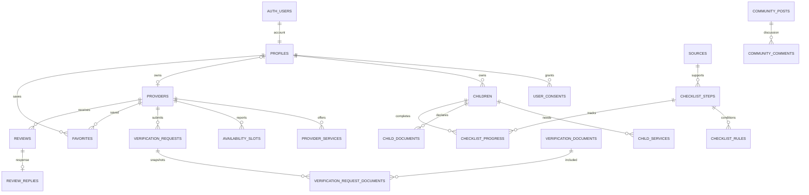

# Mama Pro — целевая схема PostgreSQL

## U1 — без новых таблиц

Короткая анкета использует ChildProfile, учебный ПМПК — needs и RouteGoal.quote/origin.
Файлы и бинарные данные не принимаются. Всё состояние остаётся в памяти вкладки.

## R1 — фактическая схема памяти

Новых таблиц и миграций нет. ChildProfile.care, providerDraft и chats добавлены к памяти вкладки.
Имена файлов квалификации хранятся как строка; binary/Storage не задействованы.
Будущий backend должен отдельно защитить care-сведения, сообщения и private qualification files
через Auth/RLS, реализовать проверку/модерацию и платежные webhooks. Клиентский published не
является доказательством оплаты или авторизации. Существующие SQL-предложения ниже не применены.

## F1 — фактически реализованное хранение

Новых таблиц/миграций нет. ChildProfile, Booking[] и ForumPost[] с комментариями живут
в React Context текущей вкладки. Refresh удаляет их. Данные не пишутся в Drizzle/Supabase,
localStorage или URL. Удаление профиля очищает связанные демо-брони.

Для будущего реального бронирования дополнить предложенную схему: nanny_profiles (provider_id,
age_min/max, languages, city), nanny_rates (nanny_id, mode, amount, currency), bookings
(parent_id, child_id, nanny_id, mode, starts_at, ends_at, status, quote_snapshot).
Связи: parent/child/nanny → bookings 1:N; nanny → rates 1:N. Контроль активных пересечений
и доступа только на сервере/в БД, не полагаться на текущий клиентский reducer.
Это дополнение для проектирования S1/S7, не применённая production-схема.

Статус: проект v1.0, 13.11.2026; **SQL и миграции ещё не созданы**.
Дополнение H1: поддержка мамы/беременности реализуется сейчас fixtures, а не постоянными таблицами.
Для дальнейшего S9.6 предлагаются `parent_activities` (id,title_ru/kk,description_ru/kk,duration_minutes,
stages[],status,is_demo,source_url?,checked_at?,version) и `personal_plan_items`
(id,user_id FK profiles,source_kind=manual/provider/activity,title,provider_id?,activity_id?,is_done,done_at?,version).
Ровно один source target соответствует kind (CHECK), у manual оба target NULL; provider/activity
FK ON DELETE RESTRICT и архивирование target без потери плана. Защита от дублей — отдельные
partial UNIQUE(user_id,provider_id) и UNIQUE(user_id,activity_id) для NOT NULL targets.
RLS только владельцу, CASCADE его аккаунта; архивный target показывается минимально как недоступный.
Это дополнение досуга и личного плана, не замена checklist_progress ребёнка и не клинический контент.
Generic досуг не выдавать за реальное мероприятие/внешний курс; для внешнего источника нужны URL/дата.
Основание: PDF стр. 11–12, M01–M18. Дополнения для FK/RLS/версий явно описаны ниже.
Внедрять таблицы по этапам S1–S10, не создавать весь backend одним изменением.

## Общие соглашения

- UUID PK (кроме join/composite PK); `created_at`, `updated_at` timestamptz в UTC у изменяемых
  сущностей. События append-only имеют только `created_at`. Справочники: UUID, slug unique,
  name_ru/name_kk, is_active, timestamps. Язык ru/kk; русский/казахский контент проверяется отдельно.
- `NULL` = неизвестно, пустой массив связей = не выбрано. Деньги numeric(12,2) ≥0, валюта KZT
  по умолчанию; 0 допускается только как явно введённая бесплатная услуга. Никогда float для цен.
- Запись времени: UTC timestamps; график — local time + IANA timezone provider (default Asia/Almaty).
  Availability expires по точному серверному времени. Browser timezone не меняет срок.
- Изменяемые агрегаты (`children`, `providers`, reviews/posts/content и requests) имеют integer
  `version` ≥1 для optimistic concurrency; PATCH/decision проверяет expected_version.
- Вводимые пользователем поля ограничены по длине и whitelist; JSON только для небольших
  фиксированных структур contacts/rules/audit metadata, не заменяет реляционные связи.
- Для владельцев ownership immutable; обычный пользователь не меняет owner/role/status/moderation.
- FK каталогов по умолчанию RESTRICT: использованные записи архивировать, не ломать историю.
  Все policy/helper/RPC и grants добавляются миграциями и тестируются на clean database.

## Обзор связей

`PROFILES |o--o| PROVIDERS`: один provider на owner в первой версии; owner nullable только у
импортированной admin-карточки. Diagram не заменяет ограничения таблиц ниже.

## A. Аккаунт и справочники (S1–S3)

| Таблица | Поля и связи | Инварианты |
|---|---|---|
| auth.users | Управляется Supabase Auth: id, email, password/phone/verification | Не создавать свою таблицу паролей, не редактировать auth schema вручную |
| profiles | id PK/FK auth.users, role, full_name?, display_name?, phone?, locale, city_id?, district_id?, status, deletion_requested_at?, version | role=parent/provider/moderator/admin; status=active/blocked/deleting. Specialist/center — provider.type. Email живёт в Auth, не публично. Staff назначается только admin-процедурой |
| user_consents | id, user_id FK profiles, purpose, policy_version, locale, action=grant/revoke, supersedes_id?, created_at | Append-only история; последний event определяет состояние purpose; отдельный purpose для sensitive_child_data; immutable text/version политики. Время/actor задаёт сервер, повтор по request_id идемпотентен |
| policy_versions | id, purpose, version, locale, body, published_at, reviewed_at, reviewer_id | UNIQUE(purpose,version,locale); опубликованный текст immutable. Это техническое дополнение для доказуемой версии согласия |
| cities | id, slug, name_ru/kk, timezone, is_active | Не hardcode Алматы в коде; Q01 выбирает город |
| districts | id, city_id FK cities, slug, name_ru/kk, is_active | UNIQUE(city_id,slug), UNIQUE(id,city_id) для composite FK профилей/поставщиков |
| languages | code PK (`ru`,`kk`, при расширении новые), name_ru/kk, is_active | Языки занятий отделены от locale UI |
| service_categories | id, slug, name_ru/kk, is_active | Включают реабилитационные/смежные, спорт/плавание/творчество без назначения лечения |
| services | id, category_id FK service_categories, slug, name_ru/kk, is_active | Справочник услуг, ≥10 для seed |
| methodologies | id, slug, name_ru/kk, description_ru/kk?, is_active | ≥5 для seed; название методики не означает одобрение лечения |
| document_types | id, slug, name_ru/kk, is_active | Справки ребёнка как типы наличия; не Storage objects |
| app_settings | key PK, value_json, updated_by, updated_at | Серверный whitelist settings: availability_ttl_days (default 7), matching weights и версия. Только admin, без секретов |

В profiles/children/providers composite FK `(district_id,city_id)` → districts `(id,city_id)`;
district требует city, оба nullable там, где поле необязательное.
Сервис ролей проверяет живой profiles.status в каждом private запросе и в RLS, не только JWT claims.

## B. Ребёнок и чек-лист (S3–S4)

| Таблица | Поля и связи | Инварианты |
|---|---|---|
| children | id, parent_id FK profiles, age_years?, age_as_of?, diagnosis_text?, city_id?, district_id?, preferred_language?, preferred_format?, is_active, version | parent role required; один активный через partial UNIQUE(parent_id) WHERE is_active. Age integer 0–21 предложено Q04; age_as_of обязателен при age. diagnosis ≤2000 символов, не публичен и не логируется |
| child_services | child_id FK children, service_id FK services | PK(child_id,service_id), ON DELETE CASCADE ребёнка |
| child_documents | child_id FK children, document_type_id FK document_types, is_present bool, updated_at | PK(child_id,document_type_id), CASCADE; строка отсутствует = неизвестно, false = сообщил отсутствие, true = сообщил наличие. Нет filename/storage_path/сканов |
| sources | id, title_ru/kk, url, publisher, checked_at, checked_by, status, version | Официальный/редакционно допустимый источник, HTTPS allowlist; checked_at не из будущего. Не выдумывать юридическую применимость |
| checklist_steps | id, slug, category, title_ru/kk, body_ru/kk, applicability_ru/kk, source_id FK sources, source_checked_at, is_general, priority, status, version | category=document/rights/equipment/provider_search; status=draft/published/archived. Публикация требует source URL и проверенной даты, оба перевода перед full release |
| checklist_rules | id, step_id FK checklist_steps, condition_json, priority, version | Малый валидируемый all/any, age_min/max, service_ids, document_present/absent. Нет произвольного code/eval/query. Несколько правил одного шага OR; внутри condition явные all/any |
| checklist_progress | child_id FK children, step_id FK checklist_steps, is_done, done_at?, updated_at | PK(child_id,step_id); CASCADE ребёнка, step RESTRICT/archive. is_done=false ⇒ done_at NULL; true ⇒ server timestamp |

Изменение анкеты и child_services/documents выполняется одной транзакцией. Parent_id берётся из
auth.uid, не из payload. Отзыв согласия блокирует чтение/запись чувствительных полей кроме
экспорта/удаления/управления согласиями. Реальное удаление ребёнка hard-delete с CASCADE трёх
зависимых таблиц; сохранность каталога, отзывов и документов provider при этом не затрагивается.

Rule schema не выводит терапию по diagnosis_text: поле хранит описание потребности для родителя,
а подбор использует явно выбранные услуги. Неизвестный age/document не удовлетворяет условию
«подтверждённо есть»; общий список `is_general=true` остаётся доступным. Age snapshot устаревает:
не вычислять ложную точную дату рождения, предлагать уточнение на возрастной границе.

## C. Поставщики, карта, кабинеты (S3,S5,S6)

| Таблица | Поля и связи | Инварианты |
|---|---|---|
| providers | id, owner_id FK profiles nullable, type=specialist/center, name, description_ru/kk?, experience_years?, photo_path?, city_id?, district_id?, address?, lat?, lng?, contacts_json, formats[], verification_status, publication_status, qualification_version, version, is_demo, source_url?, source_checked_at?, created_by | UNIQUE(owner_id) WHERE owner_id NOT NULL. verification=draft/pending/verified/rejected; publication=draft/published/hidden. Геокоординаты обе NULL или обе заданы; lat ±90, lng ±180; experience integer ≥0. Импортированные карточки owner=NULL, не получать staff owner по умолчанию |
| provider_services | id, provider_id FK providers, service_id FK services, price_from?, price_to?, currency, description_ru/kk?, min_age?, max_age?, formats[] | UNIQUE(provider_id,service_id). price_from≤price_to при обоих; nullable цена не бесплатность. min_age≤max_age, неизвестные границы допустимы. Точечный возраст — сохранение работающей функции прототипа |
| provider_methods | provider_id FK providers, methodology_id FK methodologies | Composite PK |
| provider_languages | provider_id FK providers, language_code FK languages | Composite PK; неизвестные языки = нет подтверждённых строк |
| provider_schedule | id, provider_id FK providers, weekday (1–7), starts_at time, ends_at time, timezone | starts_at<ends_at; UNIQUE(provider_id,weekday,starts_at,ends_at). Без календарной интеграции; ночной интервал разбивается на два |
| availability_slots | id, provider_id FK providers, availability_type=window/capacity, starts_at?, ends_at?, capacity?, updated_at, updated_by, version | window ⇒ timestamps обязательны, end>start, capacity NULL; capacity ⇒ integer capacity≥0, time-поля NULL. 0 = нет свободных мест, не «неизвестно» |
| favorites | user_id FK profiles, provider_id FK providers, created_at | PK(user_id,provider_id); CASCADE аккаунта, provider archive/RESTRICT; только parent |
| contact_events | id, user_id FK profiles nullable, provider_id FK providers, contact_type, event_id, created_at | contact_type phone/messenger/site/social; event_id idempotency. Нет child_id, diagnosis, полного URL назначения, IP, user-agent или свободного payload |

contacts_json строго: phone, messenger_url, website_url, social_urls[]. Только допустимые
схемы/длины/форматы, никакого HTML/javascript/data. Публичные фото отдельным обработанным asset
bucket: без EXIF и исходных приватных документов; placeholders если фото нет.

Один provider = одна карточка/адрес и владелец. Не вводить locations/offering_locations,
сотрудников центра/совместных владельцев до отдельного запроса. Владелец не может менять type
после верификации обходом PATCH; критические поля относятся к qualification_version.

Рейтинг не хранить как изменяемый пользователем providers.rating: вычислять агрегатом только
published reviews либо поддерживаемым DB view. Verified=true только если актуальная подтверждённая
заявка совпадает с qualification_version и provider не is_demo. Publication и verification — разные оси.

Availability возвращать, только если updated_at+TTL > now, window.end>now и capacity>0 (для capacity).
Ровно на границе TTL запись устарела; не надеяться на cron или длительный public cache.
Изменение TTL применяется при чтении. Обновление цены/расписания не продлевает updated_at окна.

## D. Квалификационные файлы и модерация заявки (S6)

| Таблица | Поля и связи | Инварианты |
|---|---|---|
| verification_documents | id, provider_id FK providers, uploaded_by FK profiles, bucket, storage_path, doc_type, original_filename, mime_type, byte_size, state, uploaded_at, deleted_at? | UNIQUE(bucket,storage_path); state=upload_pending/ready/deleting/deleted/rejected. 0<byte_size≤10 MiB. Путь генерирует сервер, расширение/MIME/magic проверяются сервером; object keys не публичные URLs |
| verification_requests | id, provider_id FK providers, qualification_version, status=pending/verified/rejected/superseded, submitted_by, reviewed_by?, reason?, submitted_at, reviewed_at?, version | Один pending на provider (partial UNIQUE). Решение фиксирует actor/time. reason обязателен для rejected. provider_id+id unique для composite FK |
| verification_request_documents | request_id, provider_id, document_id | PK(request_id,document_id); composite FK(request_id,provider_id)→requests(id,provider_id), FK(document_id,provider_id)→documents(id,provider_id); оба NOT NULL |

Документ ready неизменяем: замена — новая запись/object, не overwrite. Snapshot включает
qualification_version и конкретные document IDs. Superseded-заявка не меняет актуальный badge.
Submit/decision — транзакция с блокировкой provider/request. verified разрешён только для ready
snapshot и совпавшей версии; смена диплома/ФИО/типа/квалификации снимает текущую проверку и
supersedes pending. Повтор решения не создаёт новое событие. Документы не публикуются после verified.

Storage bucket `provider-verification` private, max 10 MiB, MIME PDF/JPEG/PNG; RLS путей
`{owner_id}/{provider_id}/{document_id}.{ext}` проверяет owner в БД, а не только часть пути.
Init выдаёт разрешение на конкретный object. Finalize проверяет объект/размер/содержимое и
переводит ready; публикация pending object запрещена. Удаление ready документа снимает badge.
Просмотр — короткий signed download URL (предложено 60 сек), не журналировать URL; по возможности
attachment/nosniff, осторожный sandbox preview. Удаление файла — возобновляемый шаг, не общая
транзакция PostgreSQL+Storage. Orphan upload_pending чистить по ограниченному TTL.

## E. Отзывы, сообщество, жалобы (S7–S8)

| Таблица | Поля и связи | Инварианты |
|---|---|---|
| reviews | id, provider_id FK providers, author_id FK profiles nullable при анонимизации, rating, body, status, self_confirmed_contact_at, created_at, updated_at, version, deleted_at? | rating integer 1–5; status=pending/published/rejected/hidden/deleted. Partial UNIQUE(author_id,provider_id) WHERE deleted_at IS NULL AND author_id IS NOT NULL; body 1–5000. Повторная правка ⇒ pending, owner provider не пишет отзыв самому себе |
| review_replies | id, review_id FK reviews UNIQUE, provider_id NOT NULL, author_id, body, status, version | composite FK(review_id,provider_id)→reviews(id,provider_id); только текущий owner provider. Публикация только при published родительском отзыве; один активный ответ |
| community_posts | id, author_id FK profiles nullable при анонимизации, author_alias, title, body, status, version, created_at, updated_at, deleted_at? | status=published/pending/hidden/deleted; title≤200, body≤10000, plain text/санитизированный markdown, никаких medical attachments |
| community_comments | id, post_id FK posts, author_id FK profiles nullable, author_alias, body, status, version, timestamps, deleted_at? | body≤3000, родительский post также published для публичного чтения; author update/delete только своё |
| reports | id, reporter_id FK profiles nullable, review_id?, post_id?, comment_id?, reason_code, reason_text?, status=open/resolved/dismissed, assigned_to?, resolved_at? | Ровно один typed FK target NOT NULL (CHECK), никакого невалидируемого target_type+UUID без FK. Повтор open report того же автора/объекта не создаёт дубль (partial unique по каждому target) |
| moderation_actions | id, moderator_id FK profiles nullable, action, reason, report_id?, verification_request_id?, review_id?, post_id?, comment_id?, provider_id?, created_at | Append-only, typed targets с FK; ровно один основной target. В аудите ссылки/коды/статусы, без копии медданных или полного контента |

Self-confirmed обращение не является технически доказанным посещением. Снятие published review
атомарно меняет видимый рейтинг. Блокировка автора не должна незаметно менять модерацию
опубликованных отзывов: решение об их скрытии отдельное и аудируемое (Q06).

Для сообщества предлагается постмодерация с ручным hide/report, но Q06 должен подтвердить.
Изменение hidden записи не публикует её автоматически. Авторский delete удаляет/редактирует тело
по политике, связь и минимальный audit сохраняются лишь в утверждённом retention.

## F. Контент и поддержка (S9)

| Таблица | Поля и связи | Инварианты |
|---|---|---|
| resource_categories | id, slug, name_ru/kk, is_active, timestamps | Справочник тем материалов |
| learning_resources | id, category_id FK resource_categories, title_ru/kk, description_ru/kk, url, source_id FK sources, duration_minutes, reviewed_at, reviewed_by, status, version, is_demo | duration integer>0, URL HTTPS, публикация требует источник/проверенную дату и заполненные переводы для full release |
| support_partners | id, name, description_ru/kk, conditions_ru/kk?, formats[], contacts_json, verified_at?, verified_by?, publication_status, is_demo, source_url?, version | Психологи отдельно от providers по решению PDF M15. Проверка контактов не равна verified диплома. Demo безопасные контакты без бейджа |
| support_partner_languages | partner_id FK support_partners, language_code FK languages | Composite PK, фильтр только подтверждённых языков |

Диапазоны длительности: 1–15, >15–30, >30–60, >60 минут, без двойного попадания на границе.
Ручная проверка URL по чек-листу перед публикацией; автоматическая серверная проверка внешних
URL, если будет добавлена, должна защищать от SSRF/internal IP/redirect цепочек.

## G. Эксплуатация, аудит и удаление (S1,S10)

| Таблица | Поля и связи | Инварианты |
|---|---|---|
| analytics_events | id, event_id unique, event_type, actor_id? FK profiles, entity_kind?, entity_id?, created_at | Whitelist событий и полей, без diagnosis/child_id/URL/query/raw JSON. Мелкие cohorts и сырые строки не выдавать admin; только агрегаты |
| audit_logs | id, actor_id FK profiles nullable, action, entity_type, entity_id?, changed_fields[], reason_code?, created_at | Append-only, только allowlisted field names/status, без старого/нового diagnosis, паролей и signed URLs |
| data_requests | id, user_id FK profiles nullable, kind=export/delete_account, status, stage, requested_at, completed_at?, failure_code?, request_id unique | Дополнение для возобновления короткими запросами, без отдельного worker; export output private, ограничен TTL. Клиент не пишет status/stage |
| deletion_ledger | request_id PK/FK data_requests, account_ref_hash, completed_at, expires_at | Минимальное подтверждение удаления для restore replay; без медданных. Отдельная защищённая копия; retention/правовое основание Q02 |
| rate_limit_counters | key_hash, scope, window_start, count | Composite PK, атомарное увеличение, TTL очистка. Хэш краткоживущего ключа вместо raw IP; отдельная retention-конфигурация |
| import_batches | id, created_by, kind, source_label, status, created_at, summary_counts | Ручной CSV-import с dry-run; не хранить исходные секреты/потоки медицинских данных, upsert по устойчивому source_key |
| idempotency_keys | scope, key_hash, actor_id?, request_hash, result_id?, expires_at | PK(scope,key_hash), scope включает actor+operation; одинаковый ключ с иным request_hash→409, ограниченный TTL. Для ответов хранить ссылку/безопасный summary, не копию чувствительного payload |

Эти небольшие технические таблицы не означают отдельную event platform или task queue.
Для composite FK у reviews и verification_documents добавить UNIQUE(id,provider_id),
у изменяемого reports — version. `providers.source_key` nullable unique вместе с import source
обеспечивает повтор ручного импорта без дублей. Consent supersedes принадлежит тому же user/purpose.
Metrics регистраций/профилей/verified/reviews/progress можно считать напрямую агрегатами;
contact_events учитывают клики. Analytics_events — только события, не извлекаемые надёжно из текущих таблиц.

## RLS и grants: обязательная матрица

Все доменные таблицы имеют RLS; роли app не сопоставлять с произвольными клиентскими JWT metadata.
Policy helper читает актуальный profiles.role/status без рекурсии через строго ограниченную функцию.
SECURITY DEFINER только для конкретных атомарных/административных операций, фиксированный search_path,
REVOKE EXECUTE по умолчанию, явные grants и повторная проверка actor/consent/ownership внутри.

| Данные | Гость | Parent | Provider owner | Moderator | Admin |
|---|---|---|---|---|---|
| Публичные справочники/контент/providers | Только published public projection | То же | То же + собственный draft | CRUD контента/каталога по полномочиям | CRUD |
| profiles/consents | Нет | Свои разрешённые поля/согласия | Свои | Только минимальный alias для модерации, не контакты/диагноз | Минимальный account directory, role/status отдельной процедурой |
| children и joins/progress | Нет | Только own + active consent | Нет | Нет общего доступа | Нет общего доступа |
| favorites | Нет | Только свои | Нет | Нет | Нет общего чтения |
| provider draft/services/schedule/availability | Нет | Нет | Только свой provider; критические поля через RPC | Каталог и аудит | Каталог и аудит |
| verification docs/requests | Нет | Нет | Только свои | Только проверка по роли + audit download | Проверка, без публикации сканов |
| published reviews/posts/comments | Только опубликованные отзывы; community требует parent | Public + свои private/draft | Public reviews + свои replies | Очередь и решения | То же |
| reports | Нет | Создать, статус своей жалобы | Создать на отзыв своей карточки | Рассмотрение | Рассмотрение |
| audit/moderation | Нет | Нет сырых строк | Свои решения в безопасном DTO | Только относящееся к модерации | Контрольный журнал |
| events/metrics | Contact intake с лимитом | Intake, без arbitrary events | Contact intake | Нет сырых данных | Только агрегаты |

Публичный DTO не включает owner IDs, private paths, заявки, auth-поля, анкеты и audit payload.
RLS ограничивает строки, **не колонки**: дополнительно ограничивать grants/публичные views/RPC
и проверять прямой REST/Data API, а не только Next.js handler. Для общественных имён использовать
author_alias, а не открывать весь profiles. Таблицы с техническими/privileged полями не давать
изменять общей операцией UPDATE; нужны column grants и owning RPC.

Обычный request-scoped клиент использует JWT пользователя и RLS. Secret/service-role клиент
обходит RLS: только server-only для Auth deletion/bootstrap/закрытого обслуживания после отдельной
проверки прав; не применять его как стандартный доступ всех API.

## Удаление и жизненный цикл

1. Child delete: auth+parent+ownership, CASCADE services/documents/progress, без удаления providers/reviews.
2. Account delete: fresh auth, profiles.status=deleting (моментальный запрет доступа), data_request.
3. Короткие идемпотентные шаги: children/favorites, приватные файлы owner, consent согласно политике,
   community/reviews — удаление тела или согласованная анонимизация, owner provider скрыть и отвязать
   без захвата чужим аккаунтом; обезличить аудит, удалить Auth user последним.
4. Сбой Storage/Auth не считается успехом: status pending/failed_retryable, повтор безопасен.
5. Сохранение audit/legal evidence только с утверждёнными сроками Q02, не бесконечный soft-delete.
6. Restore DB+Storage в изолированном окружении; replay подтверждённых удалений до открытия трафика.

## Индексы и атомарные операции

- Все FK owner/parent/provider/post/step + partial uniqueness выше индексировать.
- providers(publication_status,type,city_id,district_id,name,id); published subset;
  provider_services(service_id,price_from,price_to), provider_methods(methodology_id,provider_id),
  provider_languages(language_code,provider_id). Начать с ILIKE/индексов по измерениям, без Elasticsearch.
- reviews(provider_id,status,created_at,id); posts(status,created_at,id); comments(post_id,status,created_at,id);
  verification_requests(status,submitted_at); reports(status,created_at); availability(provider_id,updated_at).
- checklist_progress(child_id,is_done), child_services(service_id,child_id), sources(status,checked_at).
- RPC границы: child aggregate write; current child checklist completion; provider service/schedule set;
  verification submit/decision; moderation decision+audit; role/status change; request deletion;
  не пытаться обеспечить транзакцию цепочкой независимых `.insert()` HTTP-вызовов.
- При submit/decision сравнивать версии provider/request; при конфликте 409 без частичного состояния.

## Порядок миграций и проверки

S1 profiles/policies/consents → S3 справочники/providers/sources/checklist/moderation → S4 children/progress
→ S5 favorites/contact → S6 qualification/schedule/availability/Storage policies → S7 reviews/reports
→ S8 community → S9 resources/support → S10 lifecycle/metrics. Дополнять targets reports по мере модулей.
Каждая миграция включает grants/RLS, forward path и seed-check; destructive reset только для явного
одноразового test-проекта. Tests: constraints, direct Data API cross-user, storage owner, role escalation,
expiry/timezone, stale snapshot, CASCADE boundaries, idempotency, export/delete/restore.

Технические источники: [RLS](https://supabase.com/docs/guides/database/postgres/row-level-security),
[Storage policies](https://supabase.com/docs/guides/storage/security/access-control),
[DB backups vs Storage](https://supabase.com/docs/guides/platform/backups).
