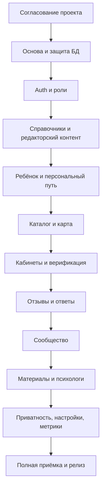

# Mama Pro — план разработки

## A1. Продуктовый аудит — 14.11.2026

- [x] A1.1 Проверить текущий код, путь на телефоне, альтернативы и соответствие критериям; сохранить выводы и приоритеты.
- [x] A1.2 Сформулировать концепцию, проверку доверия, границы AI, инклюзивный mobile UI и план проверки с родителем.

Отчёт: [PRODUCT_REVIEW_2026-11-14.md](PRODUCT_REVIEW_2026-11-14.md).

## U1. Простой путь до контакта — реализация завершена

Этап разрешён пользователем после A1; код и технические проверки завершены 15.11.2026. Не отменяет полный backlog ниже.
- [x] U1.1 Единые данные/правила выдачи по профилю, объяснения, неизвестные условия и пустая выдача; тест Астана/5 лет/kk.
- [x] U1.2 Сокращённый старт и мобильная иерархия: результаты перед фильтрами, один следующий шаг и план; дополнительные поля сохранить.
- [x] U1.3 Проверка специалиста по фактам и «Первый шаг вместе»: обращение, выбор раскрываемых данных, поддержка родителя.
- [x] U1.4 RU/KK основного пути, инклюзивные тексты, мобильные проверки, актуальный питч.
- [ ] U1.5 Проверка с настоящим родителем и редактура казахского носителем языка (не подменяется E2E).
- [ ] D1.1 Публикация в Vercel после авторизации владельца; проверить публичный адрес.

Версия: предложение v1.0 от 13.11.2026. Согласование этапов обязательно.
После S0 пользователь разрешил продолжить с учётом положения хакатона и простого интерфейса.
Сейчас выполняется H1 ниже. Full-scope M01–M18 остаётся в плане, его готовность не заявляется.

## H1. Рабочий сценарий хакатона — текущий разрешённый этап

Основание: положение (11 страниц, редакция09.11.2026), просьба пользователя продолжить;
со слов команды родитель подтвердил потребность в поддержке/активностях для мамы, включая беременность.
Полная production-платформа на финале не требуется (§2.4,6.1); сначала проверяем понятность сценария.

- [x] H1.1 Изучить положение целиком, связать критерии К1–К6 с задачами и сохранить полный backlog.
- [x] H1.2 Упростить главную/навигацию, полноценный ru/kk основного сценария и сохранение выбора при смене языка.
- [x] H1.3 Добавить сравнение 2–3 учебных поставщиков, прозрачное объяснение фильтров, профиль и подготовку обращения без фиктивной отправки.
- [x] H1.4 Добавить поддержку мамы: этап жизни, доступное время, немедицинские активности, добавление в личный план.
- [x] H1.5 Проверить оба пути на телефоне и компьютере, legacy-route/documents regression, lint/typecheck/unit/E2E/build; запустить Preview.
- [x] H1.6 Подготовить материалы концепции, 5-минутный демо-сценарий, parent-test checklist, лицензии/AI disclosure и честный список ограничений.

После H1 — отчёт и остановка перед следующим крупным этапом. S1–S11 не отменены и не объявляются выполненными.

`[x]` = выполнено с записанной проверкой в PROGRESS; `[ ]` = предстоит.
Одна строка — цель одной рабочей сессии; при росте объёма разбить на подпункты до начала,
не объединять несколько независимых задач ради формального завершения этапа.
Задача обычно занимает одну фокусную сессию; это не оценка и не обещание срока.
После **каждой задачи** обновлять этот файл и PROGRESS: изменения, проверки, ограничения, следующий шаг.
После этапа остановиться; следующий этап выполнять только по отдельной команде пользователя.

## B1. Название и визуальный стиль — текущая задача по запросу пользователя

- [x] B1.1 Согласовать название: пользователь выбрал «Бірге — вместе».
- [x] B1.2 Обновить знак, главную, общие карточки/формы/навигацию и ru/kk бренд без изменения domain logic.
- [x] B1.3 Проверить контраст/мобильную компоновку, lint/typecheck/unit/E2E/build; обновить работающий Preview.

Название продукта — «Бірге». Mama Pro остаётся названием хакатона/фонда и исторического ТЗ.

## Зависимости

## F1. Анкета, няни, сообщество и насыщенная палитра — новый запрос пользователя

- [x] F1.1 Первый вход через необязательную краткую анкету ребёнка; рекомендации/поиск по возрасту, городу, языку и задачам с редактированием профиля.
- [x] F1.2 Каталог учебных нянь, hourly/monthly/permanent, поиск/фильтры, валидируемая демо-бронь, конфликт периодов и отмена, список своих заявок.
- [x] F1.3 Учебный форум: темы/категории/поиск/сортировка, собственные посты/правка/удаление, комментарии и локальная жалоба.
- [x] F1.4 Яркая сине-бирюзово-оранжевая палитра, ru/kk, mobile; unit/E2E/lint/typecheck/build, запуск и отчёт границ.

Запрос пользователя явно добавляет бронирование и нянь к прежнему scope. В текущем окружении
без Supabase/Auth это локальные demo-reservations и forum-state, не настоящая запись/онлайн-сообщество.
Не имитировать оплату, отправку няне или подтверждение реальным поставщиком.

Это **последовательность исполнения** одним разработчиком. Технически S5 требует S2+S3,
S6 требует S2+S3+S5, S7 требует S5+S6, S8 требует S2+общей модерации, S9 требует S3.
Упорядочивание не означает, что несвязанные модули нужно связать в коде.
Dashboard в S4 работает с опубликованными DB fixtures из S3; полноценные карточки подключаются в S5.
Безопасность, ru/kk, состояния UI и проверки входят в каждый этап, S11 их сводит, а не начинает.

## S0. Анализ и контекст — текущая сессия, без кода приложения

- [x] S0.1 Прочитать все 18 страниц PDF, зафиксировать источник/версию/hash и границы.
- [x] S0.2 Проверить существующий код, стек и расхождения с прежней архитектурой.
- [x] S0.3 Создать полную карту M01–M18/экранов/NFR и предложить архитектуру/структуру папок.
- [x] S0.4 Спроектировать таблицы, связи, ограничения, RLS и приватные файлы.
- [x] S0.5 Описать API, параметры, ответы, ошибки, права и атомарные операции.
- [x] S0.6 Завершить ADR/открытые решения и инструкции AGENTS; сверить покрытие требований.

Выход: 7 контекстных файлов, прозрачные решения для согласования. **Остановиться.**

## S1. Фундамент Supabase и общие контракты

Зависимость: S0 принят; пользователь разрешил S1; утверждены ADR-01…04 и безопасный test scope Q02.
При отсутствии проектов сначала локальная/тестовая конфигурация; не создавать платные ресурсы молча.

- [ ] S1.1 Проверить доступную среду и совместимость Supabase/Next; добавить только SDK/SSR и env-validation; обновить `.env.example` без секретов. Проверка: конфигурация missing/valid, старый прототип запускается.
- [ ] S1.2 Подготовить локальный/test Supabase и единую цепочку SQL migrations; создать profiles/consents и role bootstrap без самоназначения staff. Проверка: чистая БД мигрируется и seed-профили создаются безопасно.
- [ ] S1.3 Создать первые RLS-политики/ограничения role/status и тесты parent A/B/anon/blocked. Проверка: прямой Data API также не обходит защиту.
- [ ] S1.4 Создать request-scoped server/browser clients, auth/permission helpers, стандартизованные ошибки и private no-store. Проверка: неверная/истёкшая сессия и forbidden не раскрывают данные.
- [ ] S1.5 Добавить Tailwind и минимально используемые shadcn primitives (Button/Input/Select/Dialog), общие состояния/навигацию без массовой переписки CSS. Проверка: старые экраны и клавиатурный dialog.
- [ ] S1.6 Ввести ru/kk dictionaries, locale layout и нижнюю навигацию-заготовку только для реализованных путей. Проверка: lang/locale и отсутствие неработающих ссылок.
- [ ] S1.7 Организовать integration harness для реальных RLS/миграций, CI checks и synthetic-only seed guard. Проверка: lint/typecheck/unit/integration/E2E/build.

Выход: существующий проект работает с основой Supabase и тестируемой изоляцией; auth-экраны пока не объявлять готовыми.

## S2. Аккаунт, аутентификация и согласия (M01, часть M17)

Зависимость: S1; e-mail delivery, redirect URLs и тестовые тексты согласий согласованы.

- [ ] S2.1 Email-регистрация с типом parent/provider, отдельными checkbox согласий; callback и подтверждение email. Проверка: новый/повторный email, незаполненное согласие, просроченная ссылка.
- [ ] S2.2 Вход/выход/refresh защищённой сессии, безопасные redirects и role guards. Проверка: guest, parent, provider, staff, blocked.
- [ ] S2.3 Восстановление пароля и reset-screen. Проверка: истёкший токен, повторное использование, отсутствие утечки существования аккаунта.
- [ ] S2.4 Версионированные согласия: просмотр истории, grant/revoke, блокировка sensitive write без согласия. Проверка: повторный запрос не создаёт ложные записи.
- [ ] S2.5 Профиль/настройки имени, контактов, псевдонима, района и языка; запрет role/status в PATCH. Проверка: persistence после повторного входа и ru/kk.
- [ ] S2.6 Admin bootstrap и безопасное назначение/снятие staff с аудитом; поиск/блокировка пользователей. Проверка: модератор не назначает роли, блокировка действует при старом JWT.
- [ ] S2.7 Подключить реальный SMS OTP после Q03: лимиты/бюджет/ошибки/истечение. Пока нет провайдера — скрыть вход, записать release limitation, **не отмечать задачу выполненной**.

Выход: AT-01/часть AT-17, отдельный статус SMS. Email-only test допустим по ТЗ; полный телефонный вход не считается реализованным без S2.7.

## S3. Справочники, минимальная admin и наполнение (M16)

Зависимость: S2, выбран тестовый город; для реального контента — Q01/Q05.

- [ ] S3.1 Миграции cities/districts/languages/service_categories/services/methodologies/document_types и RLS; связи БД. Проверка: уникальность slug, FK района/города, translations.
- [ ] S3.2 Admin CRUD справочников со скрытием вместо разрушительного удаления используемых записей. Проверка: роли, invalid translations/FK, состояния UI.
- [ ] S3.3 Миграции providers/provider_services/provider_methods и безопасный public DTO; опубликованные synthetic записи. Проверка: private fields не попадают в карточку.
- [ ] S3.4 Admin CRUD поставщиков и ручной CSV-import: dry-run, ошибки строк, повтор без дублей, источник, is_demo. Проверка: 12+ demo-карточек, unsafe URL и повтор импорта.
- [ ] S3.5 Источники и CRUD checklist_steps/rules; явные age/service/document условия, публикация только при источнике/дате. Проверка: 10–15 шагов и ≥3 правила.
- [ ] S3.6 Общая moderation/audit infrastructure и queues для существующих типов, причина решения. Проверка: неизменяемость аудита и отсутствие чувствительных payload.
- [ ] S3.7 Проверить synthetic seed: 2 родителя, 2 специалиста, 1 центр, 1 модератор, 1 admin; ≥10 услуг/≥5 методик. Не приписывать demo-карточкам проверенные дипломы.

Выход: опубликованные DB-записи для следующих этапов и начальная редакторская панель; AT-16.

## S4. Анкета, чек-лист и dashboard (M02, M03, M06)

Зависимость: S2+S3; согласованы возраст/категории и административные правила.

- [ ] S4.1 Children/child_services/child_documents, ownership, каскады и один активный профиль. Проверка: nullable поля/возраст/cross-user/RLS.
- [ ] S4.2 Onboarding «Пропустить/Сохранить» и редактирование ребёнка, частичное сохранение без автопубликации. Проверка: AT-02, неизвестные ответы, ru/kk.
- [ ] S4.3 Чистый детерминированный подбор и интерпретатор whitelist checklist rules без кода в JSON. Проверка: AT-03, границы возраста, unknown и полная explainability.
- [ ] S4.4 Checklist API/UI, source/date, done/undone, прогресс/следующий шаг, защита от дублей. Проверка: AT-07 и persistence после refresh.
- [ ] S4.5 Dashboard aggregate: 3–6 релевантных providers, прогресс, избранное, CTA. Проверка: нет анкеты/нет результатов/нет выполненных/всё выполнено.
- [ ] S4.6 Пересчёт при изменении анкеты сохраняет завершения; удаление ребёнка удаляет только его зависимые данные. Проверка: AT-18 и чужие сущности остаются.
- [ ] S4.7 Сквозной путь parent A/B на реальной БД, private no-store/noindex, мобильная навигация. Проверка: AT-02,03,07,17,18,20.

## S5. Каталог, карта, карточки, избранное (M04, M05, M07)

Зависимость: S2+S3, UI parent из S4; согласован tile provider/атрибуция.

- [ ] S5.1 Search API: q/type/service/language/method/district/city/price/format/age, pagination и стабильная сортировка. Проверка: комбинации, unknown, SQL injection, фильтры одной услуги.
- [ ] S5.2 Каталог-list и filter UI, сброс, empty/loading/error/«Показать ещё». Проверка: AT-04/20, клавиатура и сохранение фильтров.
- [ ] S5.3 Leaflet карта тех же search results, координаты/без координат, list toggle, добровольная геолокация и отказ. Проверка: одна выборка страниц, корректные расстояния, OSM attribution, нет PII в tile requests.
- [ ] S5.4 Постоянная `/providers/[id]`: поля/placeholder/неизвестное, карта/контакты/соцсети и derived verified. Проверка: hidden/unknown provider, private docs отсутствуют; AT-05.
- [ ] S5.5 Favorites API/UI, idempotent add/remove, приватный список. Проверка: AT-06, повторный вход, archived provider.
- [ ] S5.6 Контактные действия и ограниченное событие без текста анкеты; ошибка аналитики не блокирует контакт. Проверка: клик ≠ посещение, allowlist URI/schemes.
- [ ] S5.7 Подключить карточки к dashboard, ru/kk и основной E2E регистрации→поиска→контакта. Проверка: AT-03,04,05,06,20.

## S6. Кабинеты, документы, верификация, доступность (M09–M12)

Зависимость: S2+S3+S5; test Storage и правила проверки Q06/Q07.

- [ ] S6.1 Миграции schedule/availability/verification и provider ownership/RLS. Проверка: второй provider не меняет чужое; ограничения времени/мест.
- [ ] S6.2 Provider apply: specialist/center, черновик, отправка и повтор после отказа. Проверка: до первичной модерации не публикуется; replay submit без дублей.
- [ ] S6.3 Общий кабинет редактирования описания/фото/контактов/адреса/услуг/языков/методик/формата/цен. Проверка: только владелец; новый документ/квалификация снимает verified.
- [ ] S6.4 Private upload init/finalize/remove и просмотр: PDF/JPG/PNG ≤10 MiB, storage policies, серверная проверка содержимого/размера, attachment URLs с TTL. Проверка: wrong MIME/magic/owner/path/size, pending/orphan lifecycle.
- [ ] S6.5 Очередь и модерация верификации с version-check, snapshot документов, причиной и аудитом; публикация отдельно от badge. Проверка: AT-10, race document replacement/late decision, demo не verified.
- [ ] S6.6 График: weekday/time/timezone, редактирование недельного набора одной транзакцией. Проверка: начало<конец, нет дубликатов, AT-11.
- [ ] S6.7 Ручные окна/места, updated_at/TTL и read-time expiry. Проверка: AT-12 на границе срока даже без фонового задания, без бронирования.
- [ ] S6.8 Отдельные UX кабинеты specialist/center поверх общей модели, актуальные публичные поля/доступность. Проверка: AT-11 и ownership обоих типов.
- [ ] S6.9 Полный provider→moderator→public сценарий и audit; закрытый preview документов. Проверка: AT-05,10,11,12,17.

## S7. Отзывы, рейтинг и ответы (M08)

Зависимость: S5+S6, moderation infrastructure S3.

- [ ] S7.1 Reviews/replies/reports constraints/RLS: rating 1–5, один активный отзыв, author/owner. Проверка: отзыв не в свой provider и нет чужой правки.
- [ ] S7.2 Создание/редактирование/удаление своего, self-confirmation обращения, pending после правки. Проверка: до решения публично не виден.
- [ ] S7.3 Очередь publish/reject/hide с причиной и атомарным аудитом. Проверка: stale version конфликт, рейтинг только published и пересчёт после hide.
- [ ] S7.4 Публичное чтение отзывов/рейтинга и форма ответов владельца. Проверка: AT-09, чужой provider 403, ответ hidden-review не публикуется.
- [ ] S7.5 Жалобы и рассмотрение, feedback states, ru/kk. Проверка: AT-08/09 и повтор жалобы.
- [ ] S7.6 Seed 10 отзывов разных статусов, сквозной parent→moderator→provider. Проверка: AT-08/09, отсутствие заявления «проверенный посетитель».

## S8. Сообщество (M13)

Зависимость: S2+общие moderation/report; Q06 о политике публикации.

- [ ] S8.1 Post/comment tables, status/RLS/limits, публичный alias без child join. Проверка: parent A/B, blocked и XSS.
- [ ] S8.2 Лента/детали/создание/правка/удаление своего поста. Проверка: pagination, скрытый пост, сеть/empty/success.
- [ ] S8.3 Комментарии, создание/правка/удаление своего, удалённый parent-post. Проверка: ownership и отсутствие публикации полей ребёнка.
- [ ] S8.4 Жалоба/правила/модераторское hide/delete с причиной/историей. Проверка: жалоба в очереди, повтор/rate limit.
- [ ] S8.5 Seed ≥5 постов/≥10 комментариев/несколько жалоб, псевдонимы и ru/kk. Проверка: AT-13,17,20 и нет medical-file upload.

## S9. Материалы и психологи (M14, M15)

Зависимость: S3; проверенные внешние источники/партнёры Q05.

- [ ] S9.1 Resources/categories и support_partners schema/RLS/publish guards. Проверка: обязательные источник/дата/URL/длительность, null не подделывается.
- [ ] S9.2 Admin CRUD материалов/категорий/партнёров, ручная проверка ссылок/контактов и архивирование. Проверка: unsafe URLs и непроверенный контент не публикуются.
- [ ] S9.3 «Для меня» с интервалами длительности, источником/датой, внешними переходами. Проверка: AT-14, граничные 15/30/60 мин.
- [ ] S9.4 Каталог психологов, язык/формат/условия/контакты и предупреждение о неэкстренной помощи. Проверка: AT-15 и honest unknown.
- [ ] S9.5 Seed ≥12 ресурсов, 3 demo-психолога, все длительности/языки, ru/kk/mobile. Проверка: AT-14/15/20.
- [ ] S9.6 Перенести дополнение H1 «идеи досуга маме/беременность» в parent_activities и постоянный общий personal_plan_items (с ручными целями и выбранными providers); owner/RLS, stage/time и сохранение после входа. Сейчас это только память вкладки.

## S10. Полная приватность, настройки и статистика (M16–M18)

Зависимость: все предыдущие data-owning модули; Q02, Q06.
Базовые consent/удаление ребёнка и защита уже должны работать в S2/S4, не откладывать их сюда.

- [ ] S10.1 История политик/согласий, revoke→прекращение обработки, проверки юридического ru/kk. Проверка: все sensitive endpoints запрещены после отзыва.
- [ ] S10.2 Безопасный JSON/CSV export всех принадлежащих данных с защитой формул CSV; никакой выдачи чужих объектов. Проверка: ownership/no-store и полнота модулей.
- [ ] S10.3 Возобновляемое удаление аккаунта/Auth/файлов/данных по retention, блокировка до завершения, повтор без дублей. Проверка: DB/Storage partial failure и независимость чужих provider/review/child записей.
- [ ] S10.4 Admin user search/block/unblock, аудит critical fields и реальные последствия заблокированного старого JWT. Проверка: модератор не назначает staff и не видит анкету ребёнка.
- [ ] S10.5 Contact/analytics allowlist, агрегированные metrics, исключение demo, без диагнозов/произвольного JSON/сырых пользователей. Проверка: все метрики M18 и роли.
- [ ] S10.6 Закончить все настройки и словари ru/kk/юридический контент, проверить редкие состояния. Проверка: AT-19 и отсутствие скрытого неверного fallback.

## S11. Сквозная приёмка и выпуск

Зависимость: S1–S10; согласованные external gates для фактического объёма запуска.

- [ ] S11.1 Аудит покрытия M01–M18 и AT-01…AT-20 по карте, закрыть каждый пропуск отдельной задачей.
- [ ] S11.2 Cross-user/role/RLS/storage negative suite на живой тестовой БД; role escalation, consent revoke, blocked JWT, no cache leak.
- [ ] S11.3 Проверить SSR/SEO public stable URLs и noindex private; metadata и canonical ru/kk.
- [ ] S11.4 Mobile 360/390/768/1280, keyboard/contrast/labels/touch targets, API errors/network offline/empty/retry.
- [ ] S11.5 Проверить пагинацию 20, search/query plan и ориентир загрузки ≤3 сек на описанном мобильном профиле; не заявлять SLA без измерений.
- [ ] S11.6 Clean migrations/seed/reset, отдельный test env, DB + Storage backup/restore и replay deletion; runbook восстановления.
- [ ] S11.7 Vercel preview synthetic-only, production env/region/домен/TLS, email/SMS delivery и OSM policy; никаких секретов в build/browser.
- [ ] S11.8 Итоговые lint/typecheck/unit/integration/E2E/production build, полный демо-сценарий PDF стр.18 отдельными аккаунтами; отчёт оставшихся ограничений и разрешение публикации.

Выход: весь согласованный функционал ТЗ на БД, а не только красивый frontend. Если SMS/юридический
gate/реальный контент не готовы, выпуск честно обозначается test/demo; не отмечать весь scope выполненным.

## Приёмочная матрица исходного ТЗ

| AT | Проверка | Этап / основной модуль |
|---|---|---|
| AT-01 | Регистрация, вход, выход, восстановление | S2 / M01 |
| AT-02 | Неполная анкета и редактирование | S4 / M02 |
| AT-03 | Услуга/район меняют подбор и путь | S4,S5 / M02,M03,M06 |
| AT-04 | Поиск + 3 фильтра + та же карта | S5 / M04 |
| AT-05 | Verified и unverified badge | S5,S6 / M05,M09 |
| AT-06 | Избранное после входа | S5 / M07 |
| AT-07 | Прогресс после refresh | S4 / M06 |
| AT-08 | Pending→publish отзыв и рейтинг | S7 / M08,M16 |
| AT-09 | Owner reply, чужой provider 403 | S7 / M08,M10,M11 |
| AT-10 | Private диплом, очередь, решение | S6 / M09,M16 |
| AT-11 | Центр обновляет график/цену/окна | S6 / M10–M12 |
| AT-12 | Просроченная доступность скрыта | S6 / M12 |
| AT-13 | Пост, комментарий, жалоба | S8 / M13,M16 |
| AT-14 | Материалы по длительности | S9 / M14 |
| AT-15 | Психологи/контакты | S9 / M15 |
| AT-16 | Admin меняет шаг/источник | S3,S4 / M06,M16 |
| AT-17 | Чужие children/documents закрыты | S1,S4,S6,S10 / M02,M09,M17 |
| AT-18 | Удаление ребёнка и каскадов | S4,S10 / M02,M17 |
| AT-19 | ru→kk основные экраны | каждый этап, S10,S11 / M17 |
| AT-20 | Network/API/empty состояния | каждый этап, S11 / M18 |

Дополнительные обязательные проверки: SMS после настройки, account export/delete/restore,
privilege escalation, диапазоны цен одной услуги, истечение availability без cron,
stale verification snapshot, границы длительности, unsafe contacts/URLs, защита CSV/XSS.

## G1. Публикация исходников — запрос пользователя 14.11.2026

- [x] Проверить Git-корень, remote, исключения и отсутствие настоящих секретов в публикуемых файлах.
- [x] Закоммитить приложение и отправить `main` в `aidarBARMEN/LnD-Hack`; сохранить исходный README.

Это публикация репозитория, не deployment приложения и не подключение backend.

## R1. Правки из «Новый документ.docx» — 14.11.2026

Текущий запрос разрешает реализацию восьми блоков документа в существующем демо.
- [x] R1.1 Расширить профиль, этапы маршрута/план и убрать беременность из UI.
- [x] R1.2 Разделы поиска, фильтры/сортировка, подробные карточки и официальные справочные ссылки.
- [x] R1.3 Демо-чаты, профиль специалиста/тарифы/имитация оплаты и локальный PDF.
- [x] R1.4 Зелёный мессенджерный интерфейс, ресурсы маме, regression/check/build и запуск.

Все новые данные synthetic. Реальные платежи/авторизация/медицинское назначение не подключаются.

## M1. Просмотр как на телефоне

- [x] M1.1 Добавить `/mobile` с рамкой телефона и настоящим приложением внутри; проверить навигацию и запустить.

## T1. Пошаговая анкета и мобильное удобство

- [x] T1.1 Заменить длинную анкету на один вопрос на экран: прогресс, назад/далее, пропуск и проверка ответов.
- [x] T1.2 Необязательная ветка сведений, редактирование без потери данных, ru/kk, крупные мобильные элементы.
- [x] T1.3 Проверить ветки/возврат/валидацию/подбор и прежние сценарии, build и запустить `/mobile`.

## T2. Имя мамы и отдельные ветки анкеты

- [x] T2.1 Сначала имя родителя и выбор получателя, «Имя ребёнка» в детской ветке.
- [x] T2.2 Отдельная анкета мамы, сохранение/редактирование и подбор её поддержки.
- [x] T2.3 Проверки обеих веток, regression/build и запуск.

## T3. Пол в обеих анкетах

- [x] T3.1 Добавить необязательный пол ребёнка и родителя, сохранение/правку/обзор, PDF ребёнка; проверить и запустить.

## G2. Публикация обновлений

- [x] G2.1 Проверить состав R1/M1/T1/T2/T3, исключения/секреты и подготовить все изменения к коммиту в main.
