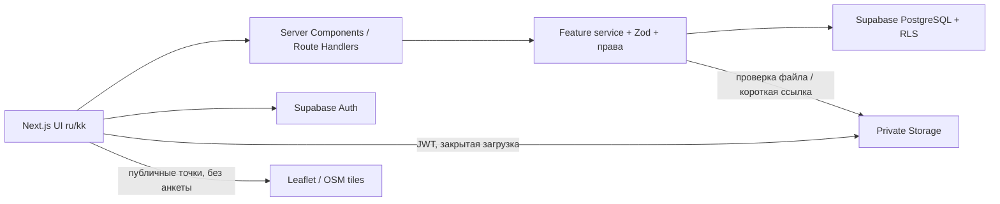

# Mama Pro — контекст проекта

## N1 — учебный чат-навигатор

15.11.2026 пользователь явно выбрал «Сначала учебный чат без передачи документов».
`/assistant` RU/KK: выбор нескольких синтетических заключений, вопросы по готовым сценариям,
цитата/страница/источник, подтверждение или отклонение каждой рекомендации, поиск и план.
Живого AI, upload/OCR и назначения по свободному диагнозу нет. Свободный текст получает
явный fallback без медицинских выводов. Локальные сообщения очищаются при уходе/refresh;
подтверждённые цели остаются в DemoProvider до refresh. Очистка чата не удаляет цели.


## U1 — согласованный простой мобильный путь

Пользователь разрешил правки A1 и предложил разбор ПМПК. Основной путь:
QuickStart → `/search` (MobileSearch на offerings) → `/providers/[id]` → `/contact/[id]` → `/route`.
Общие правила recommendOfferings с явными фильтрами. Имя/пол/медицинские поля остаются
в дополнительной анкете `/profile/child`. Четыре нижних пункта, профиль в шапке.
Расширенные разделы R1 перенесены в `/directory`; прежние карточки/чаты/няни/форум сохранены.
Главная не навязывает последовательность диагноз→ПМПК→реабилитация.
`/pmpk` — подготовленные синтетические примеры: цитата, исправление направления,
отклонение без записи, подтверждение в потребности профиля и план. Это не NLP или AI;
реальные PDF не загружаются. Для их обработки нужен отдельный защищённый этап.
Новый основной путь RU/KK; дополнительные экраны R1 не объявляются переведёнными.
Новых runtime-библиотек, миграций БД или внешней отправки сведений нет.

## A1 — мобильный продуктовый аудит 14.11.2026

Основное устройство — телефон, интерфейс прежде всего для родителя без технических знаний.
Пользователь запросил критику, сравнение альтернатив, инклюзивность, доверие и отличительную идею.
Отчёт: [PRODUCT_REVIEW_2026-11-14.md](PRODUCT_REVIEW_2026-11-14.md).
Найдены разрыв нового поиска с профилем (город/возраст/язык), неполный KK, перегрузка входа
и два разных плана. Предложение U1: единый подбор, короткий путь и «Первый шаг вместе» —
объяснимые варианты, проверка сведений и подготовка обращения с контролем раскрытия данных.
Живой AI не нужен для этого сценария. U1 — предложение, редизайн пока не реализован.
Текущий прототип и прежние требования к полям сохранены. Исторические отметки о полном RU/KK
относятся к прежнему сценарию; не объявлять весь новый R1/T2-путь двуязычным.

## T3 — пол в обеих анкетах

Необязательный sex (female/male/пусто) в ChildProfile и MotherProfile, вопрос после возраста.
Старые записи без sex совместимы; ответ есть в обзоре, профиле и PDF ребёнка, не влияет на подбор.
Повторные текстовые legend в вопросах заменены доступным именем группы через aria-label.

## Актуальное T2 — сначала родитель, затем получатель

Первый вход: имя мамы → «Кому нужна помощь?» → независимые вопросы маме или ребёнку.
Детский вопрос называется «Имя ребёнка», вопрос потребностей — «Какая помощь нужна?» в обеих
ветках. FamilyIntake/MotherQuestions в children/family-intake.tsx; MotherProfile и его валидация
в mother-profile.ts. Мама не обязана создавать ребёнка: собственный профиль, язык/город,
потребности и время; после сохранения открывается /for-me с её подбором. Редактирование
/profile/mother. Данные в DemoProvider, только память вкладки; профиль ребёнка не подменяется.

## Актуальное T1 — пошаговая мобильная анкета

Ввод/правка ребёнка теперь через один вопрос на экран, как Typeform, без внешнего сервиса.
`children/onboarding-flow.ts` определяет базовую/необязательную ветку; OnboardingScreen хранит
несохранённые ответы локально, затем атомарно обновляет прежний ChildProfile. Медицинские поля
необязательны. Назад/пропуск/обзор/точечная правка, RU/KK основные вопросы. `onboarding.css`
адаптирует touch-элементы и временно скрывает навигацию, когда анкета присутствует на странице.
`/mobile` по-прежнему показывает то же приложение в рамке телефона. Нет сторонней передачи данных.

## Актуальное дополнение R1 от 14.11.2026

Выполняется запрос из «Новый документ.docx», SHA256
6120E7032352B79B518D6153D39CEDA4A703925877EA0EE8DF66FF50632E523D.
Реализация и карта требований: R1_REQUIREMENTS.md. Новые экраны на русском,
существующая локализация не удалена. Основная навигация: Главная/Поиск/Чаты/Для меня/Профиль.
Зелёный слой messenger.css поверх прежних стилей; логотип/иконки мессенджера не копируются.
Профиль имеет необязательный care; список помощи по отметкам, не свободному тексту диагноза.
Этапы `/journey` отличаются от задач `/route`. Новый `/search` отделяет специалистов и дневные
центры; старый `/catalog`/compare/documents остаются рабочими. Сообщество внутри «Для меня».
Чаты/профиль специалиста/имитация оплаты/сведения ребёнка по-прежнему в памяти вкладки.
Файл квалификации: только имя, без чтения содержания. PDF создаётся в браузере (pdf-lib,
fontkit, локальный Noto Sans); тарифы в src/config/provider-plans.ts. Реальные данные не вводить.
Предыдущее требование о беременности отменено новым: удалено из runtime. Исторические docs
сохраняют описание прежних этапов и не являются основанием вернуть его в интерфейс.

Публичное название приложения после выбора пользователя — **Бірге**. Mama Pro здесь и в
исторических документах обозначает исходный продуктовый brief/хакатон. См. BRAND_GUIDE.md.

Статус full-scope v1.0: проектирование S0 выполнено. Дата анализа: 13.11.2026.
После нового запроса пользователя выполняется H1: рабочий сценарий хакатона с простым интерфейсом,
сравнением, ru/kk и поддержкой мамы. См. HACKATHON_DELIVERY/HACKATHON_PITCH и PROGRESS.
S1–S11 остаётся полным планом, готовность этих backend-модулей не заявляется.

## Текущий F1: разрешённое расширение прототипа

Анкета → прозрачный подбор специалистов, 4 учебные няни/3 формата демо-брони/отмена,
форум родителей с темами/комментариями/поиском и насыщенная палитра. Новые модули:
`features/children`, `features/nannies`, `features/community`, `lib/search.ts`, `locales/family.ts`.
Всё состояние — React Context/useReducer в памяти вкладки. Нет сохранения в БД, реальной записи,
оплаты, общей публикации или настоящей модерации. Подбор — совпадение условий, не медицинский вывод.
Новые зависимости не добавлены. Новые пользовательские экраны переведены на ru/kk.

## Как продолжить без истории чата

1. Прочитать `../AGENTS.md`, этот файл, `PROGRESS.md`, `DEVELOPMENT_PLAN.md`.
2. Проверить решения Q01–Q10 в `DECISIONS.md`. Не считать предложения утверждёнными.
3. Прочитать нужные разделы `DATABASE_SCHEMA.md` и `API_CONTRACTS.md`.
4. Выполнять только разрешённый этап, небольшими задачами; после каждой задачи обновлять план и прогресс.

Корень приложения: `Project/17-49-06-11-2026-2` относительно рабочего каталога `Hack LnD`.
Не создавать новый Next.js-проект и не переносить всё приложение в новый каталог `web`.

## Основание и приоритет требований

Полностью прочитан PDF «Полное_ТЗ_веб_приложение_реабилитация_v1.0.pdf», версия 1.0 от 13.11.2026, **18 страниц**.
Исходный файл: `C:/Users/User/Downloads/Полное_ТЗ_веб_приложение_реабилитация_v1.0.pdf`.
SHA-256: `4038803F4B6AB6F33D7623357881962662AD03B62C15B94BFD43DDAFD62AFB4B`.
Исходный PDF не изменён. Полный текст извлечён постранично; визуально проверены листы со всеми страницами.

Требование пользователя — реализовать весь M01–M18, включая бывший этап 2; сессия S0 была только
проектированием. По последней команде H1 сначала закрывает основные пути рабочего прототипа.
Технические решения из PDF — проектные предложения, а не отдельное разрешение менять код,
создавать платные ресурсы или публиковать реальные данные. Старое ТЗ v0.1 отдельно не перечитывалось:
его трассировка содержится на стр. 18 нового PDF.

Новый запрос и согласованные решения имеют приоритет. Эти документы предлагают новую целевую
архитектуру; `architecture-v1.1.md`, `roadmap.md`, `research.md`, старые outputs остаются историей
демо «Маршрут семьи». Их требование живого AI, Drizzle, ветки Pilot и сложная модель филиалов
не переносятся автоматически в Mama Pro. Изменение основания записано в ADR-01.

## Продукт и границы

Mama Pro помогает родителю найти проверяемую справочную информацию, административные шаги,
специалистов/центры и поддержку для себя. Путь: регистрация → необязательная анкета ребёнка →
dashboard и чек-лист → поиск/карта → карточка → избранное/контакт → отзыв. Поставщик ведёт свою
карточку и доступность; модератор проверяет документы, отзывы и контент; администратор ведёт систему.

В полный объём входят сообщество, внешние материалы по длительности, психологи-партнёры,
оба кабинета поставщиков, ru/kk, настройки, экспорт/удаление и агрегированные метрики.

Исключения из ТЗ (стр. 2, 9, 14): нативные приложения, оплата, бронирование, календарная синхронизация,
видеосвязь и realtime/личный чат, автоматическая государственная проверка дипломов, собственные
курсы и транспорт, глубокая интеграция соцсетей. Медицинские файлы ребёнка загружать не требуется:
`child_documents` — отметки наличия справок, не сканы. AI/LLM не требуется.

## Фактическое состояние репозитория

| Область | Есть сейчас | Нужно для полного ТЗ |
|---|---|---|
| Основа | Next.js 16.4.6, React 19.3.1, TypeScript strict, Zod, Node 24 | Сохранить, проверить совместимость перед точечными изменениями |
| UI | Собственный CSS, core `/ru` и `/kk`, simple home/catalog/compare/provider/contact/for-me/route; legacy documents RU | Общие Tailwind/shadcn-компоненты постепенно; остальные full-scope экраны |
| Каталог | 7 синтетических fixtures, город/возраст/категория/язык, dialog, сравнение и стабильные страницы | PostgreSQL, услуги/методики/цены/районы/формат, карта, реальные проверенные контакты |
| Маршрут | Цели и варианты в React Context, сброс при refresh | Персональный чек-лист и прогресс в БД, dashboard и правила |
| Документы | 3 подготовленных учебных текстовых разбора | Сохранить как legacy-demo; не смешивать с дипломами поставщиков |
| Backend | Drizzle/pg-конфигурация, пустая доменная schema | Supabase Auth/DB/Storage/RLS, миграции и CRUD |
| Доступ | Нет auth/ролей/изоляции в БД | M01, M09–M17, ownership и RLS |
| Проверки | Vitest и Playwright, ранее 27 unit и 6 E2E | Расширить, не считать старые проверки приёмкой M01–M18 |

В сессии S0 приложение не менялось. В H1 меняется UI/core UX и i18n; зависимости/SQL/Storage не добавлены.
Существующий маршрут полезен как UX-прототип, но не эквивалентен постоянному чек-листу ТЗ.
Сохранение ручных целей и legacy `/ru/route`, `/ru/documents` в новом продукте — Q08.

## Полная карта функционала

Во всех пунктах нужны реальные записи БД (кроме явно обозначенного seed), проверка прав,
loading/empty/error/success и мобильный интерфейс. Номера страниц — страницы исходного PDF.

| ID / источник | Функциональность и обязательные детали | Этапы | Приёмка |
|---|---|---|---|
| M01, стр. 4 | Email/пароль, подтверждение email; SMS OTP при реальном провайдере; выбор родитель/поставщик; отдельное согласие на чувствительные данные; восстановление, выход и ошибки истёкшего кода; profiles, защищённые роли, auth + RLS; без фиктивного SMS | S1,S2,S10,S11 | AT-01,17; отдельный SMS gate |
| M02, стр. 4 | Возраст, диагноз/потребность, имеющиеся справки, услуги, язык, район; каждое поле необязательно; пропуск, частичное сохранение, редактирование и удаление; один активный ребёнок в UI, модель допускает расширение; анкета влияет на подбор и чек-лист, не раскрывается поставщику | S4,S10 | AT-02,03,17,18 |
| M03, стр. 4–5 | Dashboard: процент и счётчик прогресса, ближайший невыполненный шаг, 3–6 подходящих карточек, быстрые действия; один агрегированный запрос, избранное; пустая анкета предлагает заполнение, отсутствие результатов честно показывается | S4,S5 | AT-03,07,20 |
| M04, стр. 5 | Поиск имени/названия/услуги; список/карта; тип поставщика, услуга, язык, методика, район, min/max цены, online/offline; плавание/спорт/творчество; комбинация фильтров; район/название или расстояние от добровольной точки; отказ геолокации; сброс и пагинация; координат нет — карточка остаётся в списке с объяснением отсутствия на карте | S3,S5 | AT-04,20 |
| M05, стр. 5–6 | Постоянная карточка: фото/плейсхолдер, услуги/опыт/язык/методики/формат/цены, телефон/мессенджер/сайт/соцсети/адрес/карта; рейтинг только опубликованных отзывов; бейдж только verified, сканы закрыты; актуальная доступность и дата; избранное/контакт; неизвестное = null/«Не указано»; клик контакта не посещение | S5,S6,S7 | AT-05,06,11,12 |
| M06, стр. 6 | Адаптивный административный чек-лист: документы, права/льготы, оборудование/покупки, поиск специалистов; описание/условия/официальный источник/дата; done/undone, прогресс/следующий шаг; правила возраста/потребности/имеющихся документов; общий список при неполных данных; сохранение прогресса; никаких назначений и обязательных покупок по диагнозу | S3,S4 | AT-03,07,16 |
| M07, стр. 6 | Приватное избранное: сердечко в списке/карточке, отдельный список, удаление/переход, сохранение между входами, уникальная пара user/provider | S5 | AT-06 |
| M08, стр. 6–7 | Отзыв 1–5, текст/дата, самоподтверждение обращения; pending до модерации; один активный отзыв на provider; правка повторно pending; удаление своего; жалобы; публичный ответ владельца; рейтинг только published, пересчёт при скрытии | S7 | AT-08,09 |
| M09, стр. 7 | Заявка specialist/center: анкета, контакты/адрес/услуги/методики/языки/цены/график, загрузка PDF/JPG/PNG дипломов; черновик/подача/проверка/отказ с причиной/повтор; private Storage; ручная верификация; новая карточка скрыта до первичной модерации; редакторские карточки допустимы без бейджа | S6 | AT-05,10,17 |
| M10, стр. 7 | Кабинет специалиста: свои описание/фото/адрес/языки/методики/услуги/цены, график/окна, отзывы/ответы, замена документов; ownership каждого запроса; изменение квалификации снимает verified и требует повторной проверки; цены/расписание сразу, аудит автора/даты | S6,S7 | AT-09,10,11 |
| M11, стр. 8 | Кабинет центра: название/логотип/адрес/контакты, услуги/методики/языки/форматы/цены/график, места/окна/документы/ответы; общая provider-модель, один владелец; без реестра сотрудников/филиалов | S6,S7 | AT-09,10,11 |
| M12, стр. 8 | Ручной CRUD целочисленных мест/временных окон, метка updated_at; справочный индикатор, без резервирования; устаревшие записи скрываются при чтении даже без cron; предложенный TTL 7 дней, admin-настройка | S6 | AT-11,12 |
| M13, стр. 8–9 | Лента, подробный пост, создание/правка/удаление своего поста; комментарии и удаление своего, жалобы и правила; псевдоним, без автоматических данных ребёнка; модератор скрывает/удаляет; предлагаемая постмодерация требует согласования; без вложений меддокументов/личных сообщений | S8 | AT-13,17,20 |
| M14, стр. 9 | «Для меня»: внешние курсы/видео/статьи, тема/описание/длительность/URL/источник/дата проверки; интервалы до 15, 15–30, 30–60, 60+ минут; редакторский CRUD/проверка ссылок, без LMS | S9 | AT-14 |
| M15, стр. 9 | Отдельный каталог support_partners: психологи, языки/формат/описание/условия/контакты; телефон/мессенджер/внешняя запись; обновляет модератор, дата актуальности; сообщение «не экстренная помощь»; без внутренних консультаций | S9 | AT-15 |
| M16, стр. 9–10 | Admin: очередь заявок/жалоб, закрытый просмотр дипломов по временной ссылке, решение с причиной/историей; модерация отзывов/постов/комментариев; CRUD поставщиков/услуг/методик/районов/языков/шагов/правил/источников/ресурсов/психологов; поиск/блокировка аккаунтов; аудит и отсутствие назначения staff самим пользователем | S1,S3,S6,S7,S8,S9,S10 | AT-08,10,13,16,17 |
| M17, стр. 10 | Имя/псевдоним/контакты/язык/район, профиль ребёнка, согласия/политика/история, полный ru/kk; удаление ребёнка/аккаунта, приватный экспорт JSON/CSV; политика хранения и проверенные юридические переводы, no silent fallback | S2,S4,S10 | AT-17,18,19 |
| M18, стр. 10 | Общие метрики регистраций, заполненных анкет, контактных кликов, verified-поставщиков, published-отзывов и done-шагов; без диагнозов/свободного текста в аналитике; стандартизованные ошибки, retry и все UI-состояния | S1,все,S10,S11 | AT-20 |

Второй этап исходного продукта покрыт M10–M15/M16, а не отложен в неопределённый backlog.
Исходная трассировка FR-1…FR-24 на стр. 18 покрыта указанными M01–M18; новые требования
M17/M18, безопасность, API и NFR также включены.

## Навигация и экраны

Все UI URL имеют `/[locale]`, сначала `ru`, затем полноценный `kk`. API не имеет locale-префикса.
Пути ниже логические, например `/search` означает `/ru/search` или `/kk/search`.

| Зона | Экраны |
|---|---|
| Public | `/`, `/login`, `/register`, `/forgot-password`, `/auth/callback`, `/reset-password`, `/search`, `/providers/[id]`, `/for-me`, `/psychologists`, `/privacy`, `/community/rules` |
| Parent | `/onboarding`, `/dashboard`, `/my-journey`, `/favorites`, `/community`, `/community/[id]`, `/profile`, `/profile/child`, `/settings` |
| Provider | `/provider/apply`, `/provider/dashboard`, `/provider/services`, `/provider/schedule`, `/provider/reviews` |
| Moderator/admin | `/admin`, `/admin/providers`, `/admin/content`, `/admin/community`, `/admin/users` (только admin), `/admin/metrics` (только admin) |

Мобильная нижняя навигация родителя: Главная/dashboard, Поиск, Сообщество, Для меня, Профиль.
Чек-лист доступен с dashboard и `/my-journey`; избранное — через поиск/профиль.
Гость не получает чужую персонализацию и не пишет отзывы/посты. В демонстрации смена ролей
выполняется входом в отдельные тестовые аккаунты, а не переключателем привилегий в UI.

## Предлагаемая архитектура



Один Next.js App Router проект, без отдельного backend-сервиса. Server Components вызывают
feature service напрямую; Route Handlers `/api/v1` используют те же функции для браузерных действий.
Server Actions допускаются как тонкие обёртки тех же сервисов при реальной пользе; не создавать
параллельную бизнес-логику и не делать внутренний HTTP-запрос сервер → собственный API.

Supabase SDK с сессией пользователя для обычных запросов, SQL migrations и RLS для данных.
Атомарные многошаговые операции — небольшие PostgreSQL RPC: submit/decision, замена наборов
услуг, checklist-update, lifecycle удаления. Без универсального repository framework, очереди
сообщений, Redis, realtime и отдельного worker. Очистка файлов/аккаунта — возобновляемая
задача в таблице, короткие шаги в Next.js; расписание — только если действительно потребуется.

Предлагается единый владелец SQL-миграций — Supabase migrations. Имеющийся Drizzle не удалять
заранее: после согласования и появления замены убрать только неиспользуемую связку, не вести
две независимые схемы. Tailwind/shadcn внедрять на новых общих компонентах, затем точечно
переиспользовать старые. Логику фильтров/reducer и тесты сохранять там, где контракты совпадают.

## Структура папок (целевая, создаётся по мере этапов)

```text
src/
  app/
    [locale]/
      (public)/       # landing/search/providers/for-me/psychologists/privacy
      (auth)/         # login/register/forgot-password/reset-password
      (parent)/       # onboarding/dashboard/my-journey/favorites/community/profile/settings
      (provider)/provider/  # apply/dashboard/services/schedule/reviews
      (staff)/admin/        # providers/content/community/users/metrics
      layout.tsx
    auth/callback/route.ts
    api/v1/           # тонкие Route Handlers, см. API_CONTRACTS.md
  features/
    auth/ profile/ children/ catalog/ checklist/ dashboard/
    providers/ reviews/ community/ resources/ support/ moderation/ analytics/
    routes/ documents/ # существующее demo; судьба — Q08, пока сохранять
    # Обычно contracts.ts, service.ts и UI; дополнительные файлы при необходимости
  components/
    ui/               # только используемые shadcn primitives
    shared/           # navigation, states, provider-card, source-link, form-field
  ui/                 # текущий demo-shell, переносить лишь при замене
  lib/
    supabase/         # browser.ts, server.ts; привилегированный клиент отдельно server-only
    auth/ permissions/ env/ validation/ errors/ i18n/
  locales/ru.ts, kk.ts
supabase/
  migrations/         # таблицы, ограничения, политики, точечные RPC
  seed/               # synthetic development/test, без настоящих медицинских данных
tests/
  unit/ integration/ e2e/  # текущие тесты не перемещать без необходимости
docs/                 # эти файлы; исторические документы сохранены
```

Route groups не меняют URL и не создают второй landing для уже занятого пути.
Не создавать пустые слои/папки заранее. Русские строки и новые экраны сразу проектировать
через типизированные ключи; к полному релизу нужен kk и отредактированный двуязычный контент.

## Персонализация

Явные фильтры поиска — ограничения, а не слабые пожелания. Цена/язык неизвестны — не считать
бесплатным/подходящим при обязательном фильтре. Интервал цены должен совпасть на одной услуге,
а не на разных услугах одного центра. Неизвестные поля профиля не ограничивают рекомендации.

Рекомендации dashboard ранжируются детерминированно: услуга +5, язык +2, район +2,
формат +1, verified +1, координаты +0,5 (предложение ТЗ, Q04). При равенстве — расстояние,
если добровольно дано, затем нормализованное имя и id. Наличие координат не доказывает
качество лечения. Общий поиск без сортировки «рядом»: район, имя, id; отказ геолокации не ошибка.
Возрастные диапазоны из прототипа сохранить как дополнительное ограничение, если указаны
поставщиком; неизвестный возраст не объявлять подтверждённым совпадением.

Чек-лист — опубликованные административные шаблоны и небольшой whitelist условий,
без исполняемого JS/SQL в JSON. Диагноз — необязательный частный текст, не медицинский триггер.
Состояние завершённых шагов сохраняется при пересчёте, скрытые правилами шаги не теряют
историю прогресса; удаление ребёнка удаляет его прогресс.

## Безопасность и эксплуатационные границы

- Проверка сессии на сервере, актуальной роли/блокировки в БД и ownership + RLS. Пользователь
  не меняет role/status/owner/verification через массовый PATCH. Auth metadata не источник staff-прав.
- Медицинские сведения доступны владельцу; у staff нет общего права читать детей.
  Исключительный доступ оператора, если понадобится, требует отдельного решения и аудита.
- Диагноз, имя ребёнка, ответы анкеты, токены и подписанные ссылки не попадают в публичные URL, аналитику,
  логи, публичный cache, сообщения внешним партнёрам или OSM. Private ответы no-store; private UI noindex.
- Отдельное согласие на чувствительные данные. Отзыв согласия прекращает их обработку;
  удаление/экспорт и согласованный retention нужны до реальных данных, не после релиза.
- Документы поставщиков private, короткие signed URLs только владельцу/модератору,
  не выдаются публичной карточкой. Upload до 10 MiB: напрямую в Storage; Next.js принимает
  только metadata/init/finalize. Причина — лимит тела Vercel Functions 4,5 MB.
- Только проверенные источники для прав/льгот/организационных шагов, дата проверки и видимый
  disclaimer. Не придумывать диагнозы, назначения, рейтинги, контакты или дипломы.
- Отдельные dev/test/prod Supabase-проекты; только synthetic в preview. Регион, юрисдикция,
  тексты согласий, retention и доступ операторов — gate перед реальными данными (Q02).
- DB backup не содержит бинарные Storage objects: нужны отдельный backup файлов и проверка
  восстановления. После restore повторно применить удаления до открытия доступа.
- Stateful rate limit не хранить в глобальной переменной Vercel. Использовать лимиты Auth плюс
  минимальный атомарный limiter в Postgres для upload/post/report/contact; без нового Redis.

Технические основания проверены 13.11.2026: [Supabase SSR](https://supabase.com/docs/guides/auth/server-side/creating-a-client),
[RLS](https://supabase.com/docs/guides/database/postgres/row-level-security),
[Storage access](https://supabase.com/docs/guides/storage/security/access-control),
[Vercel payload](https://vercel.com/docs/functions/limitations),
[регионы Supabase](https://supabase.com/docs/guides/platform/regions),
[backup DB/Storage](https://supabase.com/docs/guides/platform/backups),
[OSM tiles policy](https://operations.osmfoundation.org/policies/tiles/).
Это технические источники, не юридическое заключение. Перед реализацией перепроверять только
применимые изменяемые API и использовать bundled Next.js guides для установленной версии.

## Общая приёмка

Все M01–M18 и AT-01…AT-20, плюс отдельная проверка SMS при подключённом провайдере;
FK/constraints/RLS на настоящей тестовой PostgreSQL; cross-user и escalation tests;
mobile 360/390/768/1280, клавиатура, контраст, ru/kk; сеть/empty/errors; production build,
проверенный seed, инструкции env/migrations, restore rehearsal и журнал ограничений.
Текущая сессия завершает документацию, а не эту продуктовую приёмку.
